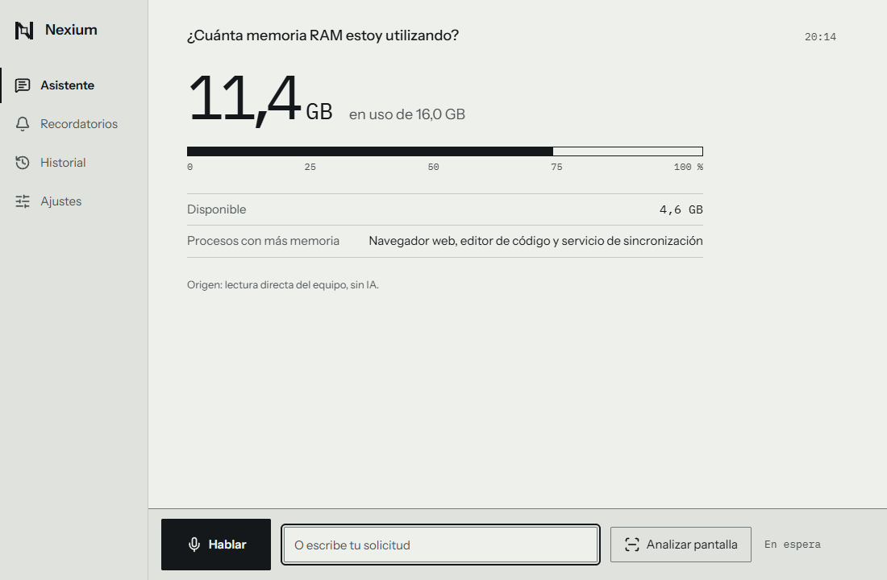
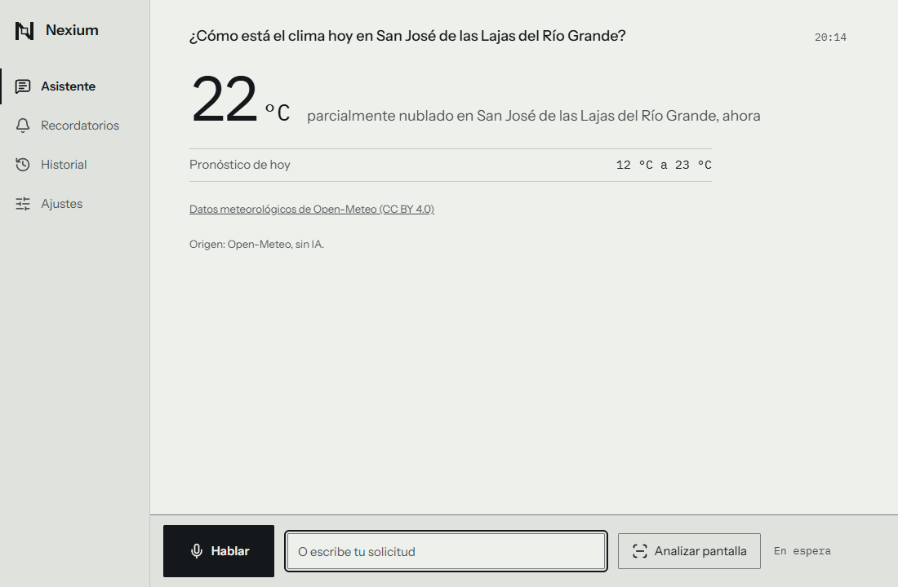
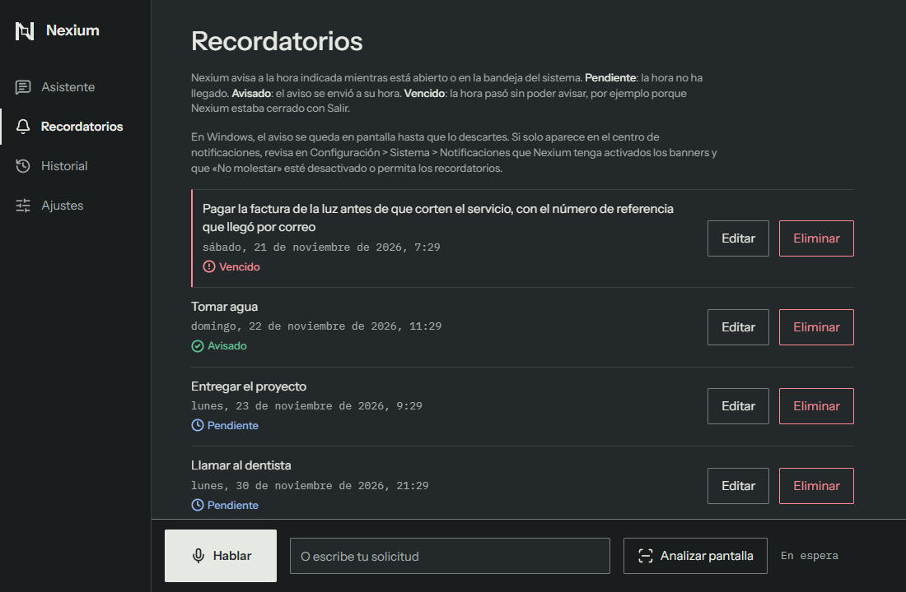

# Nexium

Asistente inteligente de escritorio para Windows, macOS y Linux. Entiende solicitudes en español, por voz o por texto, y responde con datos reales de tu equipo: hora, CPU, memoria, batería, red, archivos, documentos, clima, recordatorios y análisis de pantalla bajo demanda.

Los hechos salen del equipo, no de un modelo. La IA interpreta lo que pides, pero solo la aplicación ejecuta operaciones, mediante funciones controladas. La voz se transcribe en tu equipo.

## Descargar

Desde la [página de la última versión](https://github.com/Daniel-I24/Nexium/releases/latest), descarga solo el archivo de tu equipo (`x.y.z` es el número de versión):

| Tu equipo | Descarga este archivo |
|---|---|
| Windows 10 u 11 (64 bits) | `Nexium_x.y.z_x64-setup.exe` |
| Mac con Apple Silicon (M1, M2, M3 o M4) | `Nexium_x.y.z_aarch64.dmg` |
| Mac con Intel | `Nexium_x.y.z_x64.dmg` |
| Linux: Ubuntu o Debian | `Nexium_x.y.z_amd64.deb` |
| Otras distribuciones de Linux | `Nexium_x.y.z_amd64.AppImage` |

Los demás archivos de la página (`.sig`, `.app.tar.gz`, `latest.json` y el código fuente) son técnicos: los usa el actualizador de Nexium y no hace falta descargarlos. Cómo instalar en cada sistema, y qué hacer con los avisos de SmartScreen y Gatekeeper, está en [Instalación](#instalación).

| | |
|---|---|
|  |  |
|  | |

## Funciones

- **Voz:** botón visible, micrófono solo mientras la barra está en amarillo, transcripción local con Whisper.
- **Sistema:** CPU, RAM, batería, Internet, Wi-Fi, nombre de la red y modo oscuro. Lo que un sistema no permite consultar aparece como "No disponible", nunca con un valor inventado.
- **Archivos:** búsqueda en las carpetas que autorices (Documentos y Escritorio, o las que elijas con el selector del sistema): por nombre y, en `.txt`, `.md` y `.csv`, también por contenido. Nunca modifica, mueve ni elimina nada.
- **Documentos:** «Resume mi documento de bases de datos» o «Analiza este archivo». Lee en el equipo `.txt`, `.md`, `.csv`, PDF con texto y `.docx`, ofrece los archivos por relevancia (primero los que coinciden por nombre) y pide tu confirmación antes de enviar su texto a la IA. El resumen tiene dos o tres frases, de cinco a ocho ideas clave explicadas y los datos importantes (fechas, cifras, definiciones). Un PDF escaneado o un formato no compatible se explican.
- **Varias cosas a la vez:** «¿A qué red Wi-Fi estoy conectado? Y dame el clima». Hasta cuatro solicitudes en una misma petición, por voz o por escrito: cada una se responde en su propio bloque y en orden, y si una falla o espera tu confirmación, las demás se responden igual. El Historial guarda una sola entrada con el resultado de cada parte.
- **Pantalla:** una sola captura en memoria, comprimida y enviada al servicio de IA, y después descartada.
- **Clima y hora:** condiciones actuales y pronóstico de Open-Meteo; hora del equipo. Sin ciudad en la solicitud se usa la de Ajustes, y si no hay ninguna, Nexium la pregunta y ofrece guardarla.
- **Recordatorios:** en lenguaje natural, con aclaración si la fecha es ambigua. Se guardan en SQLite, con tres estados: Pendiente, Avisado (el aviso salió a su hora) y Vencido (la hora pasó sin poder avisar). En Windows, el aviso se queda en pantalla hasta que lo descartes.
- **Historial:** solicitudes, categoría, estado y respuesta, sin audio ni imágenes. Cada solicitud tiene una sola entrada, que se actualiza hasta su estado final aunque pase por un permiso o una pregunta.
- **Actualizaciones:** en **Ajustes > Actualizaciones**, solo cuando lo pides. Nexium instala únicamente versiones publicadas aquí y firmadas con su clave.

## Requisitos mínimos

| Sistema | Versión | Procesador y memoria | Disco |
|---|---|---|---|
| Windows | Windows 10 (1809) u 11, de 64 bits, con WebView2 (incluido en Windows 11; el instalador lo descarga si falta) | x86-64 de 4 núcleos y 8 GB de RAM | 250 MB con el modelo de voz preciso |
| macOS | macOS 12.3 Monterey o posterior | Apple Silicon (M1 o posterior) o Intel, 8 GB de RAM | 250 MB con el modelo de voz preciso |
| Linux | Ubuntu 24.04, Debian 13 o equivalentes, con WebKitGTK 4.1 y PipeWire | x86-64 de 4 núcleos y 8 GB de RAM | 250 MB con el modelo de voz preciso |

El modelo de voz **Automático** (por defecto) usa Preciso con 4 núcleos y 8 GB de RAM o más, y Rápido (60 MB) en equipos más modestos; en Ajustes puedes ver qué eligió y por qué, y cambiarlo. La IA, el clima y las actualizaciones necesitan Internet; las consultas del equipo y la voz, no.

## Instalación

Descarga el instalador de tu sistema desde la [página de la última versión](https://github.com/Daniel-I24/Nexium/releases/latest). Descarga los instaladores únicamente de ahí.

Nexium es un proyecto universitario y sus instaladores no están firmados con un certificado comercial, así que el sistema avisará la primera vez. No hace falta desactivar ninguna protección del sistema.

### Windows

1. Descarga `Nexium_x.y.z_x64-setup.exe` y ábrelo.
2. Si aparece **«Windows protegió su PC»** (SmartScreen), pulsa **Más información** y después **Ejecutar de todas formas**. Aparece porque el instalador no lleva una firma comercial ([opciones de firma](docs/ANALISIS_TECNICO.md#firma-del-instalador-de-windows)).
3. Sigue el asistente, en español. Instala solo para tu usuario y no pide permisos de administrador.
4. Abre Nexium desde el menú Inicio.

### macOS

1. Descarga `Nexium_x.y.z_aarch64.dmg` si tu Mac tiene Apple Silicon, o `Nexium_x.y.z_x64.dmg` si es Intel. Lo ves en **Menú Apple > Acerca de este Mac**: «Chip Apple M…» es Apple Silicon; «Procesador Intel…» es Intel.
2. Abre el `.dmg` y arrastra Nexium a **Aplicaciones**.
3. Abre Nexium. macOS dirá que no puede comprobar el desarrollador (Gatekeeper).
4. Ve a **Ajustes del Sistema > Privacidad y seguridad**, baja hasta el aviso sobre Nexium y pulsa **Abrir igualmente**. Confirma con tu contraseña. Solo hay que hacerlo una vez.
5. La primera vez que hables o analices la pantalla, macOS pedirá permiso de micrófono o de grabación de pantalla.

### Linux

**Ubuntu o Debian (`.deb`):**

```bash
sudo apt install ./Nexium_x.y.z_amd64.deb
```

**Cualquier distribución (`.AppImage`):**

```bash
chmod +x Nexium_x.y.z_amd64.AppImage
./Nexium_x.y.z_amd64.AppImage
```

### Primeros pasos

1. En **Ajustes**, descarga el modelo de voz que marca el modo automático (una sola vez; se verifica su integridad).
2. Pulsa **Hablar** o escribe, por ejemplo: «¿Cuánta batería me queda?», «¿Cómo está el clima en Bogotá?», «Recuérdame llamar al dentista mañana a las 10» o «Resume mi documento de bases de datos».

### Actualizaciones

En **Ajustes > Actualizaciones**, pulsa **Buscar actualizaciones**. Si hay una versión nueva, Nexium la descarga, comprueba su firma, la instala y se reinicia. Nunca busca por su cuenta.

## Privacidad

La IA viene integrada: no necesitas configurar ninguna clave. Tus solicitudes y capturas **pasan por el servidor de Nexium hacia Google Gemini**, en su capa gratuita. El servidor no guarda su contenido; solo registra métricas de uso y errores, y cuenta el uso con un identificador anónimo de instalación y tu dirección IP, que no se almacena. Detalles en [`server/README.md`](server/README.md).

Según los [términos de Google](https://aistudio.google.com/docs/terms), en los servicios no pagados:

- Google puede usar lo que envías y las respuestas para mejorar sus productos y tecnologías de aprendizaje automático.
- Personas pueden leer esos datos, tras desvincularlos de tu cuenta.
- Google pide **no enviar información sensible, confidencial o personal**.

Esto importa sobre todo en el **análisis de pantalla** y en el **resumen de documentos**: antes de cada captura y de cada documento, Nexium avisa de todo esto y nombra a Google Gemini. Sin pulsar Capturar, no se toma ninguna imagen; sin confirmar el archivo concreto, no se lee ni se envía ningún documento. No envíes pantallas ni documentos con datos personales.

| Dato | ¿Sale del equipo? | Destino |
|---|---|---|
| Hora, CPU, RAM, batería, red, modo oscuro | No | |
| Voz | No: Whisper la transcribe localmente | |
| Nombres y rutas de archivos, y la búsqueda por contenido | No | |
| Texto de un documento, solo tras confirmar ese archivo y como mucho 30 000 caracteres | Sí | Servidor de Nexium, y de ahí Google Gemini. El historial guarda el nombre y el resumen, no el contenido |
| Texto de una solicitud no resuelta por reglas locales | Sí | Servidor de Nexium, y de ahí Google Gemini |
| Captura de pantalla, solo tras confirmar | Sí | Servidor de Nexium, y de ahí Google Gemini |
| Ciudad del clima | Sí | Open-Meteo |

Otras condiciones de esos términos: hay que tener 18 años o más, el servicio está pensado para desarrolladores con fines profesionales o comerciales, y en el Espacio Económico Europeo, Reino Unido y Suiza una aplicación ofrecida a usuarios solo puede usar servicios de pago.

## Arquitectura

```text
React (solo presentación)
   │  comandos tipados de Tauri; ninguno genérico ni con rutas de archivos
   ▼
Rust: reglas locales ──► IA si hace falta ──► Intent validado ──► CommandHandler
        SystemProvider · FileSearchProvider · DocumentProvider · WeatherProvider
        AiProvider · SpeechProvider · ScreenCaptureProvider · NotificationProvider
   │  solo si hace falta IA
   ▼
Servidor intermediario de Nexium (Cloudflare Worker)
   valida cada solicitud, limita el uso por instalación, por IP y en total, y guarda la clave
   ▼
Google Gemini
```

La clave de Gemini solo existe como secreto de Cloudflare: nunca en el código, los instaladores, la CI ni tu equipo. El servidor tiene su propio [README](server/README.md).

```text
src/            Interfaz: app, components, features, services, types, styles
src-tauri/src/  commands, core, providers, services, database, models, platform
server/         Servidor intermediario de IA, con sus pruebas
tests/          Contratos entre la interfaz y Rust, y pruebas de diseño
docs/           Análisis, diseño, estado, rendimiento, voz y pruebas manuales
```

## Configuración

Quien usa Nexium no configura nada para la IA. **Ajustes** muestra el estado del servicio y el uso de hoy. El límite diario lo pone el servidor de Nexium para cada equipo y red; si se alcanza, Nexium dice a qué hora se restablece y no reintenta. Las operaciones locales no consumen cuota.

Las órdenes simples (hora, fecha, batería, CPU, RAM, red, Wi-Fi, modo oscuro y abrir secciones) se resuelven en el equipo, sin IA. Los tiempos de cada solicitud quedan en `rendimiento.log` (como mucho dos archivos de 256 KB), en la carpeta de datos de Nexium, sin el texto pedido: ver [`docs/RENDIMIENTO.md`](docs/RENDIMIENTO.md).

### Voz

El modelo se descarga una sola vez desde **Ajustes**, con tu confirmación, y se verifica su hash. Se guarda en la carpeta de datos de la aplicación, dentro de `models/`. Se carga en memoria mientras hablas, la primera vez que pulsas Hablar, y se libera tras un periodo sin uso, configurable en **Ajustes** (10 minutos por defecto). En automático, Nexium usa el primer micrófono real y nunca una entrada que grabe el sonido del equipo, como Stereo Mix, aunque sea la predeterminada. Detalles y mediciones: [`docs/PRUEBA_VOZ.md`](docs/PRUEBA_VOZ.md).

### Notificaciones de los recordatorios

Los recordatorios avisan con una notificación del sistema mientras Nexium está abierto o en la bandeja. El título lleva un emoji según el contenido (💊 medicina, 💧 agua, 🗓️ reunión o cita, 📚 estudio o entrega, 🛒 compras, 🏃 ejercicio y 🔔 en el resto), elegido en el equipo sin IA. En Windows usan el escenario de recordatorio: el aviso aparece desplegado, con el botón **Abrir Nexium**, que abre Recordatorios con ese recordatorio resaltado, y se queda en pantalla hasta que lo descartes. Que aparezca en pantalla depende de la configuración de Windows:

- En **Configuración > Sistema > Notificaciones**, las notificaciones deben estar activadas y, en la lista de aplicaciones, Nexium debe tener activado **Mostrar banners de notificación**.
- Con **No molestar** activado, Windows solo muestra los avisos de las aplicaciones y recordatorios que permitas en **Establecer notificaciones prioritarias**. Si no, el aviso va directamente al centro de notificaciones.
- Al ejecutar Nexium sin instalar (en desarrollo), Windows atribuye el aviso a PowerShell; el instalado lo firma como Nexium.

## Desarrollo local

### Requisitos para compilar

- Node.js 22.12 o superior y Rust 1.90 o superior (con `rustup`).
- CMake y `libclang`, que necesita Whisper.
- Los [requisitos de Tauri 2](https://tauri.app/start/prerequisites/) de cada sistema.

**Windows:** Visual Studio Build Tools con "Desktop development with C++" incluye CMake. `libclang` se puede extraer del [paquete oficial de LLVM](https://github.com/llvm/llvm-project/releases) sin privilegios:

```powershell
# Tras dejar libclang.dll en %USERPROFILE%\.nexium-tools\llvm-<versión>\bin
. .\scripts\dev-env.ps1
```

No compiles dentro del directorio temporal de Windows: MSBuild falla allí.

**macOS:** Xcode Command Line Tools y `brew install cmake`.

**Linux (Ubuntu 24.04 o superior):** Ubuntu 22.04 no compila, porque `xcap` requiere encabezados de PipeWire más recientes que los suyos. Los paquetes generados en CI tampoco están pensados para distribuciones anteriores a 24.04.

```bash
sudo apt-get install -y libwebkit2gtk-4.1-dev build-essential curl wget file libxdo-dev libssl-dev \
  libayatana-appindicator3-dev librsvg2-dev libasound2-dev cmake pkg-config libclang-dev libxcb1-dev \
  libxrandr-dev libdbus-1-dev libpipewire-0.3-dev libwayland-dev libegl-dev libgbm-dev
```

### Ejecución

```bash
npm ci
npm run tauri dev
```

### Variables de entorno

| Variable | Cuándo | Uso |
|---|---|---|
| `NEXIUM_AI_SERVER_URL` | Al compilar | Dirección del servidor de Nexium. Sin ella, la compilación no incluye IA. No es secreta |
| `GEMINI_API_KEY` | Solo en desarrollo, en `.env` | Sin `NEXIUM_AI_SERVER_URL`, `tauri dev` llama directamente a Gemini con esta clave. Ese código no existe en los instaladores |

### Compilación

```bash
npm run tauri build
```

whisper.cpp se compila optimizado también en distribución gracias a la característica `force-debug` de `whisper-rs-sys`: sin ella, con MSVC quedaba sin optimizar y cada transcripción tardaba unos 13 s. Ver [`docs/RENDIMIENTO.md`](docs/RENDIMIENTO.md).

Cada envío a `main` compila los instaladores de prueba en GitHub Actions. Al subir una etiqueta `v*`, el flujo **Publicación** compila los instaladores firmados en un borrador de Release, con el `latest.json` que consulta Nexium, comprueba cada compilación y solo entonces la publica. Las notas se generan con `scripts/release-notes.mjs` a partir de `.github/release-notes.md` (tabla de descarga e instalación) y `.github/changes/<versión>.md` (novedades), que debe existir antes de crear la etiqueta.

whisper.cpp se compila para procesadores x86-64 comunes (AVX2, sin las instrucciones del servidor que compila: ver `src-tauri/.cargo/config.toml`), y la CI falla si su parte de CPU contiene instrucciones AVX-512 (`scripts/check-cpu-baseline.sh`). Nexium comprueba en ejecución que el procesador tiene esas instrucciones antes de usar la voz. La clave privada de firma llega como secreto del repositorio (`TAURI_SIGNING_PRIVATE_KEY` y `TAURI_SIGNING_PRIVATE_KEY_PASSWORD`) y nunca está en el código.

## Pruebas

```bash
npm run lint             # ESLint y reglas de Tailwind
npm test                 # Vitest: interfaz y contratos con Rust
npm run test:layout      # Playwright: 23 vistas en 5 tamaños de ventana, 6 escalas de texto y 2 temas
cd src-tauri && cargo fmt --check && cargo clippy --all-targets -- -D warnings && cargo test
cd server && npm ci && npm run typecheck && npm test
```

La CI ejecuta todo esto en Windows, macOS y Linux, y las del servidor aparte. Pruebas con servicios reales, que gastan cuota y nunca se ejecutan en CI (estas y las mediciones de voz están en [`src-tauri/tools`](src-tauri/tools/README.md)):

```bash
cd src-tauri
cargo run --example ai_live -- frases
```

Las pruebas manuales están en [`docs/PLAN_PRUEBAS_MANUALES.md`](docs/PLAN_PRUEBAS_MANUALES.md).

## Limitaciones conocidas

- Los recordatorios solo avisan mientras Nexium está abierto o en la bandeja. Al salir del todo no hay avisos, y los vencidos aparecen al volver a abrirlo.
- La búsqueda por contenido solo mira archivos de texto (`.txt`, `.md`, `.csv`) de hasta 1 MB, con un límite de 4 s por búsqueda.
- Un PDF escaneado no tiene texto que leer: Nexium no reconoce texto en imágenes.
- El nombre de la red Wi-Fi depende de permisos de ubicación en Windows 11 24H2 y en macOS.
- Open-Meteo es gratuito solo para uso no comercial. **Un uso comercial requiere un plan de pago.**
- Las respuestas se muestran en texto. No hay voz sintetizada en esta versión.
- La base de datos local no está cifrada. Contiene solicitudes y respuestas, que puedes eliminar desde Historial.
- La IA necesita Internet y comparte una cuota gratuita limitada: en días de mucho uso puede agotarse hasta el día siguiente. Las consultas locales siguen funcionando.
- La IA no está disponible en el Espacio Económico Europeo, Reino Unido ni Suiza, porque los [términos de Google](https://aistudio.google.com/docs/terms) solo permiten allí servicios de pago. Tampoco cuando no se puede determinar el país, como en la red Tor. El servidor lo decide según el país que informa Cloudflare, y Nexium lo explica con un mensaje. Las consultas locales siguen funcionando.
- Solo se ha probado a mano en Windows. En macOS y Linux se compila y se prueba automáticamente en la CI, pero faltan las pruebas manuales.
- Los instaladores no llevan firma comercial: SmartScreen y Gatekeeper avisan la primera vez.

## Atribución

Datos meteorológicos de [Open-Meteo](https://open-meteo.com/), con licencia [CC BY 4.0](https://creativecommons.org/licenses/by/4.0/). Tipografías Instrument Sans e IBM Plex Mono, con licencia OFL. Reconocimiento de voz con [whisper.cpp](https://github.com/ggml-org/whisper.cpp), con licencia MIT.

## Licencia

[MIT](LICENSE). © 2026 Daniel-I24.
